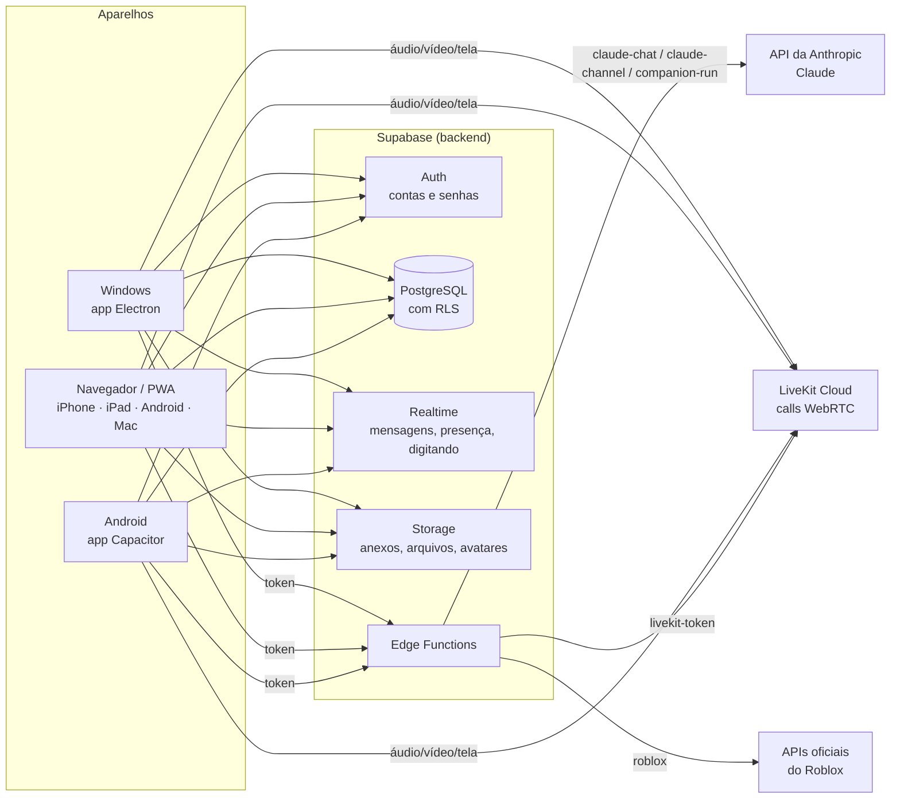
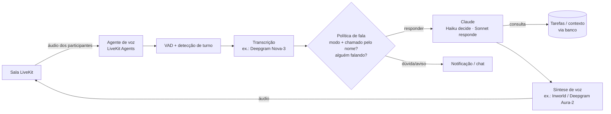

# Arquitetura do NEXUS

## Visão geral

* **Um único app** (`apps/web`) roda em todos os lugares. O app do Windows (Electron) e o do Android (Capacitor) só "embalam" esse app e adicionam recursos do sistema (bandeja, notificações nativas, compartilhar tela, permissões de microfone).
* **Segredos ficam só no servidor**: a chave da Anthropic e as chaves do LiveKit são segredos das Edge Functions. O app só tem a chave **pública** do Supabase, e o próprio app recusa chaves secretas (`config.ts`).
* **Regras de acesso no banco (RLS)**: cada consulta é filtrada pelo Postgres conforme quem está logado. Mesmo que alguém modifique o app, não consegue ler o que não pode. 114 testes automáticos cobrem essas regras (`supabase/tests`, resultados em `docs/TESTES.md`).

## Banco de dados (supabase/migrations)

| Migração | Conteúdo |
|---|---|
| 0001 núcleo | perfis, administradores do app, configurações, servidores, cargos (24 permissões), membros, canais (texto/voz, privados), convites, banimentos, funções de permissão, proteção contra escalada de privilégio |
| 0002 mensagens | mensagens de canal e privadas (DM 1:1 e grupo), menções (@usuario, @Claude, @todos), notificações, não lidas, busca em português |
| 0003 projetos e arquivos | projetos, tarefas/bugs/melhorias, versões, histórico de alterações (escrito por gatilhos, não pode ser forjado), arquivos com pastas e visibilidade (o banco já guarda versões de arquivo; a tela de versões é a próxima etapa) |
| 0004 Claude | conversas, mensagens, uso por dia (tokens e custo), liberação de acesso, pedidos de @Claude (anti-duplicação), cotas e orçamento |
| 0005 finanças e Roblox | lançamentos (receita/despesa, bruto, taxas, estimado/pendente/recebido/pago), orçamentos, resumo por moeda, jogos vinculados, coletas de métricas com origem e horário, conta Roblox e tokens em esquema privado |
| 0006 Companion | modos, permissões (10 escopos), tarefas com 7 estados, trava por recurso, dúvidas com urgência e rota, registros (logs) |
| 0007 storage e realtime | buckets com políticas por caminho, publicação do realtime, canais privados de presença (`server:`, `dm:`, `user:`) |

Quem paga o Claude é o administrador do NEXUS (primeiro usuário cadastrado). Por isso o Claude só responde para: administradores, pessoas liberadas individualmente, e cargos com "Usar o Claude" em servidores criados por um administrador. Há limite diário por pessoa e orçamento mensal global.

## Tempo real

* **Mudanças no banco** (Postgres Changes, respeitando RLS): mensagens, canais, cargos, membros, notificações, tarefas.
* **Presença** em canais privados por servidor (`server:<id>`): quem está online, ausente, e em qual call (com microfone/câmera/tela). Só membros conseguem assinar (política em `realtime.messages`).
* **Digitando…** via broadcast no mesmo canal.

## Calls (Grupo 1)

* LiveKit (WebRTC). A função `livekit-token` confere no banco se a pessoa pode entrar no canal de voz e quais fontes pode publicar (microfone, câmera, tela) de acordo com os cargos, e assina um token de 6 h.
* No Windows, o compartilhamento de tela usa um seletor próprio (telas/janelas) e pode incluir o áudio do sistema.
* No iPhone/iPad/Android o navegador não permite compartilhar a tela; voz e vídeo funcionam.

## Claude AI (Grupo 2)

* `claude-chat`: conversa pessoal com streaming (SSE). Envia histórico, anexos (imagem, PDF, texto/código) e o **contexto do projeto consultado com a identidade da pessoa** (tarefas, finanças só se ela puder ver, métricas do Roblox com origem). Registra tokens e custo estimado.
* `claude-channel`: resposta a `@Claude` no canal, com as últimas 30 mensagens; publica uma mensagem "pensando…" e depois a resposta. Uma mensagem só é respondida uma vez.
* Modelos configuráveis pelo administrador: Sonnet 5.5 no chat, Opus 5.5 nas tarefas (Haiku 5.5 para economizar).

## Claude Companion (seção 5 da especificação)

### Já implementado (texto e tarefas)

* **Modos** (só quando chamado, participante ativo, segundo plano, híbrido — padrão). Hoje valem para as tarefas: o modo entra nas instruções do executor e muda a rota das dúvidas (em “só quando chamado” e “segundo plano”, dúvida que não bloqueia vai para as pendências sem notificar). Na call, passam a valer com a voz (fase 5). Nos canais de texto o Claude só responde a @Claude, em qualquer modo.
* **Tarefas em segundo plano** (`companion-run`): rodam no servidor; cada chamada trabalha ~100 s, salva o estado e se chama de novo (com `NEXUS_INTERNAL_SECRET`). Continuam com o app minimizado ou fechado.
* **Estados**: aguardando, executando, aguardando confirmação, bloqueada, concluída, falhou, cancelada. Pausar/retomar/cancelar/repetir pelo app.
* **Concorrência**: limite de tarefas simultâneas por pessoa e **trava por recurso** (duas tarefas no mesmo arquivo nunca rodam juntas — índice único no banco).
* **Dúvidas**: o Claude usa a ferramenta `perguntar_usuario`. Bloqueante → pausa só aquela tarefa; não bloqueante → registra nas pendências e segue. Urgência média/alta vira notificação.
* **Permissões** (10 escopos), concedidas só pelo dono, sempre registradas. Ferramentas checam o escopo **e** as permissões do servidor; negação vira registro e o Claude é avisado.
* **Ferramentas atuais**: progresso, perguntar, listar tarefas do projeto, criar tarefa/bug, listar e ler arquivos de texto/código, resumo financeiro, ler mensagens de um canal.
* **Histórico**: tarefas, ferramentas usadas, arquivos lidos, perguntas, respostas, permissões, falhas. Pode ser exportado (JSON) e excluído pela pessoa.

### Fase 5 — voz nas calls (planejado)

* O agente entra como participante identificável ("Claude"), só em salas autorizadas (`ouvir_call`, `falar_call`), com indicador de escuta e botões de silenciar, pausar escuta e remover.
* **Interrupção**: se alguém começa a falar, a fala do Claude para (barge-in), sem cancelar tarefas.
* A voz é um processo separado: análise demorada não trava a voz, e a call não cancela tarefas.
* Não guarda gravações por padrão (`transcript_retention_days = 0`).
* Custos e opções em `docs/CUSTOS.md`. Só será ativado com a sua autorização.

## Roblox e finanças (Grupos 3 e 5)

* Métricas públicas oficiais (`games.roblox.com/v1/games`, `apis.roblox.com/universes/v1/places/{id}/universe`): jogadores online, visitas, favoritos, sempre com **origem e horário da coleta**; histórico vem das próprias coletas do NEXUS.
* Receita: a API oficial **Analytics Query API** (Open Cloud) tem a métrica `DailyRevenue` com chave de API `universe.analytics:read` — próximo passo (fase 6), ver `docs/ROBLOX.md`. **Nunca** usamos senha ou cookie `.ROBLOSECURITY`.
* Finanças separam bruto, taxas, estimado, pendente, recebido e pago; importações não duplicam (`external_ref` único).

## App do Windows

* Electron 45, janela sem moldura (barra de título própria), protocolo `app://nexus/`, sandbox + contextIsolation, só abre links externos no navegador.
* Fechar = minimizar para a bandeja (tarefas e calls continuam). Menu da bandeja: abrir, verificar atualizações, iniciar com o Windows, sair.
* Notificações nativas, contador no ícone da barra de tarefas, seletor de tela com áudio do sistema, atualização automática pelo GitHub Releases.
* Instalador NSIS em português, instala sem administrador (como o Discord), atalhos na área de trabalho e menu Iniciar.
